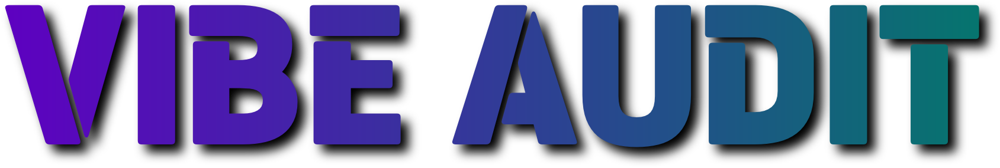
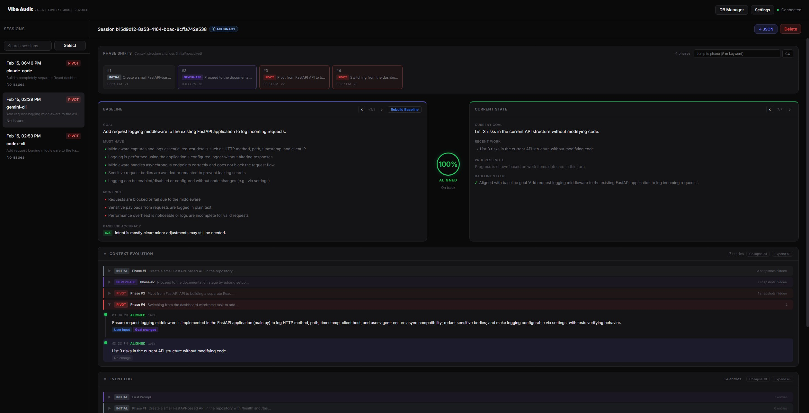

<p align="center">
  
</p>

<p align="center">
  <strong>Agent Context Audit Console</strong><br />
  <em>Keep your coding agents on intent.</em>
</p>

<p align="center">
  
</p>

<p align="center">
  
  
  
  
</p>

<p align="center">
  
</p>

## 1. Overview

Vibe Audit collects and analyzes work sessions from Claude Code, Gemini CLI, and Codex CLI to show:
- whether the agent is still working within the context you intended
- when a context shift (pivot) happens

Its purpose is to trace agent conversations and monitor context drift.

### Why This Is Needed

In vibe coding, agents can drift from user intent during long sessions.
- goals get subtly reinterpreted
- prior context gets compressed, lost, or distorted
- output looks fine, but unrequested work is still happening

Vibe Audit makes these moments visible so humans can step in at the right time.
It helps you supervise the agent while keeping work aligned with intent.

### Core Features

- Baseline auto-generation from user intent
- Phase-shift detection: `continuation`, `new_phase`, `pivot`
- Alignment score with rationale ("Why this score")
- Dual flag detection (rule-based + LLM-based)
- Context Evolution / Event Log tracking
- Automatic baseline version switch on pivot
- DB backup/restore from the UI

## 2. Installation

Running with `npx` is recommended.
At first launch, onboarding runs so you can configure hooks for your CLI setup.

```bash
npx vibe-audit
```

## 3. Settings

Open `Settings` in the top-right of the web app.

- Set the LLM model used for baseline/alignment analysis
- Add API keys (OpenAI / Gemini / Anthropic) as needed
- Configure AI response language, interface language, and timezone
- For custom models, use LiteLLM `provider/model` format (example: `openai/gpt-5.2`)

## 4. DB Manager

Open `DB Manager` in the top-right of the web app.

- `DB Download`: exports the current SQLite backup
- `DB Upload`: restores from a backup file and replaces current DB data
- You can use it to migrate sessions across machines or recover local history
- After upload, restart is recommended for a clean state refresh

## 5. Additional Commands

You can re-run onboarding or configure hooks manually:

```bash
# Run onboarding wizard
node bin/cli.js init

# Gemini hook (run in the target project)
# Re-run `setup-gemini` for each new project path.
node bin/cli.js setup-gemini

# Claude + Codex global hooks
node bin/cli.js setup-hooks

# Environment diagnostics
node bin/cli.js doctor
```

## 6. Data and Privacy

Vibe Audit runs 100% locally.
- Runtime data: `~/.vibe-audit`
- Main DB: `~/.vibe-audit/vibe_audit.db`
- Settings: `~/.vibe-audit/settings.json`

## 7. Current Limitations

Vibe Audit is currently in beta. You may see:
- different outcomes across CLIs due to event-format differences
- partial loss of the last turn if execution is force-stopped during streaming
- boundary-case variation because alignment/phase classification includes LLM interpretation

## License

MIT

