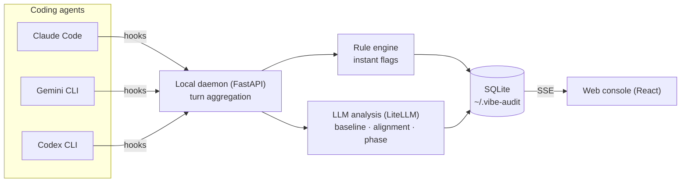

<p align="center">
  
</p>

<p align="center">
  <strong>Keep your coding agents on intent.</strong><br />
  A local audit console for Claude Code, Gemini CLI and Codex CLI sessions.
</p>

<p align="center">
  
  
  
  
  
</p>

<p align="center">
  <a href="media/vibe-audit.mp4"></a>
  <br>
  <sub><a href="media/vibe-audit.mp4">Watch the full video (0:45)</a></sub>
</p>

```bash
npx vibe-audit
```

## Why

You ask an agent to *add request logging to the FastAPI app*. An hour later it reports "Done ✓", and somewhere along the way it also refactored the auth module, built a React dashboard and migrated the database. In long vibe-coding sessions, agents drift: goals get reinterpreted, earlier context gets compressed or lost, and the output still looks fine while unrequested work piles up.

Reading every transcript doesn't scale. Vibe Audit watches the session for you and shows **when** the agent left your intent, **how far**, and **why it thinks so**, so you can step in at the right moment.

## Features

- **Baseline from intent.** Your first prompt becomes a baseline of goals, must-haves and must-nots.
- **Alignment score.** Every turn is scored against the baseline, with a "why this score" explanation.
- **Phase-shift detection.** Each new instruction is classified as `continuation`, `new_phase` or `pivot`. A pivot automatically starts a new baseline version, so the record stays honest about what you actually asked for.
- **Dual flags.** Instant rule-based flags for risky actions (`rm -rf`, `DROP TABLE`, `.env` access, credentials in code, network calls) plus LLM-based flags for drift the rules can't see.
- **Context evolution.** A timeline of every baseline version, phase and event, so you can see exactly when and how the intent changed.
- **100% local.** Sessions live in SQLite on your machine. Back up and restore the database from the UI to move between machines.

## How it works



Lightweight hooks forward each agent's events to a local daemon, which groups them into turns. The rule engine flags known dangerous patterns immediately; the LLM pass builds and versions the baseline, scores alignment and classifies phase shifts. The console updates live over server-sent events. Any model LiteLLM supports can drive the analysis, including OpenAI, Gemini and Anthropic.

## Getting started

```bash
npx vibe-audit
```

The first launch runs an onboarding wizard that sets up hooks for the CLIs you use, then opens the console.

**Settings** (top right): choose the analysis model (any LiteLLM `provider/model`, e.g. `openai/gpt-5.2`), add API keys, and set the response language, interface language and time zone.

**DB Manager** (top right): download the SQLite database as a backup, or upload one to restore. Restart after a restore for a clean state.

### CLI commands

```bash
node bin/cli.js init            # re-run the onboarding wizard
node bin/cli.js setup-hooks     # Claude Code + Codex CLI global hooks
node bin/cli.js setup-gemini    # Gemini CLI hook, run once per project path
node bin/cli.js doctor          # environment diagnostics
```

### Data and privacy

Everything runs locally. Nothing leaves your machine except the calls to the LLM provider you configure.

| | Path |
|---|---|
| Runtime data | `~/.vibe-audit` |
| Database | `~/.vibe-audit/vibe_audit.db` |
| Settings | `~/.vibe-audit/settings.json` |

## Known limitations

Vibe Audit is in beta.

- Event formats differ between CLIs, so results can vary slightly by agent.
- Force-stopping an agent mid-stream can lose part of the last turn.
- Alignment and phase classification include LLM judgment, so borderline cases can vary between runs.

## License

MIT

---

Built by [Yoo Heehyeon](https://hhkb.dev) at [Intbox](https://intbox.org).
